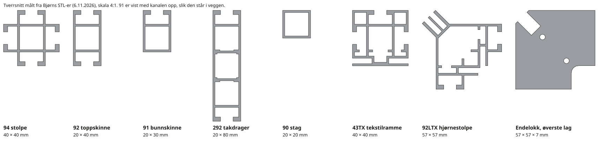

# Foga System: byggesystemet bak standen

Alt som bygges i en stand er Foga System (Bjørn, 31.10.2026). **Flex** brukes til alt som ikke er tekstil
(vegger, takdrager, disker, dører). Veggplatene er lakkert HDF, ikke Foga. **Fabric** (TX-profiler) brukes til tekstilvegger, og standardprofilen er
**43TX**. Gulv, møbler, strøm og annen løsøre er ikke Foga og ligger utenfor Foga-motoren.

Kilde: *Foga System Designer's Guide* versjon 01.07 (PDF fra Bjørn, 80 sider). Nyere utgave:
<https://issuu.com/fogasystem/docs/designersguide_2024_ver01>. Artikkelnumre under er Fogas egne.

Koden for dette ligger i `src/foga/` (se nederst). Selve byggereglene står nummerert, én gang, i
[byggeregler.md](byggeregler.md); her er bakgrunnen, målene og hvorfor.

## 1. Grunnprinsippet: én kanal for alt

- Alle Flex-profiler har samme kanal: **9 mm åpning, 10 mm dyp**, i et **20 mm raster**. Profilene er 20,
  30, 40 eller 48 mm brede.
- Fordi kanalen er lik overalt, passer **alle koblinger i alle profiler**.
- De fleste profiler er «upright or rail»: samme profil kan være stolpe eller skinne.
- Arbeidshesten er **92** (20 × 40 mm, kanal på begge kortsider).

### Koblinger (skinne mot stolpe, hjørner, skjøter)

| Kode | Art.nr | Hva den gjør |
| --- | --- | --- |
| 615A | 871 055 92 | Standard. T-hode i kanalen klemmer skinne mot stolpe |
| 615B | 871 056 92 | Som 615A, skrue fra siden |
| 600 | 871 003 92 | Justerbart hode, skrue skjult i kanal eller på siden |
| 600QF | 871 062/063 92 | Verktøyfri (vri 90°). Lette rammer, lysbokser |
| 608B | 871 034 92 | Settes inn fra fronten. Rask montering, f.eks. dør mellom to stolper |
| 608BL / 608BR | 871 035/036 92 | 45°, til skråstag |
| 610 / 617 | 871 038 / 871 045 92 | 90° i kanalen, gjæret eller butt hjørne (617 er sterkere) |
| 613 | 871 043 92 | Flat plate for gjæret hjørne. Hjørne for 01TX, 03TX, 43TX, 81TX ifølge guiden; vi bruker 617 i stedet |
| 614 | 871 044 92 | Sterk intern kobling. **Hjørne for 92TX, 80TX** |
| 624 / 625 | 871 061 / 871 057 92 | Intern gjæring i plast (624 alle vinkler) |
| 604 | 871 031 92 | Forlenger i kanalen, brukes i par |
| 609 / 609QF | 871 037 / 871 050 92 | Forlenger inne i hulprofil |
| 606 | 871 032 92 | Kile som skjøter to stolper parallelt |
| 618 | 871 041 92 | Holder to parallelle profiler sammen |
| 540 | 871 540 92 | Skinne som møter siden av en annen (takgrid, avstivning) |

Hull for 600, 608 og 615B: Ø 10 mm, **28,6 mm fra profilenden**.

### Stolpeprofiler for hjørner og knutepunkt

| Profil | Mål (mm) | Bruk |
| --- | --- | --- |
| 92 | 20 × 40 | Rett stolpe eller skinne |
| 92B | 40 × 40 (flens) | 5 mm plater med magnet eller borrelås |
| 92L / 92R | 30 × 30 | 90° hjørne (R med hyllestøtte) |
| 92LL | 60 × 30 | Dobbelt 90° hjørne |
| 66 | Ø 40, 6 kanaler | Sekskant / flere retninger |
| 82 / 84 | 48 | 135° |
| 85 | 34 × 48 | 180° (T) |
| 88 | 48, 8 kanaler | Åttevei |
| 90 / 91 | 20 × 20 / 20 × 30 | Firkant, lette skinner |
| 292 / 293 / 294 | større | Kraftigere stolper (294 for store konstruksjoner) |

### Plater i Flex

- Plate står i kanalen: **platemål = synlig mål + 18 mm** i både bredde og høyde (9 mm inn i hver kanal).
- **Maks platetykkelse 9 mm.** Kanaladapter 301 tar plater opp til 37 mm, 114 tar 40 mm.
- Plastkanal 333 for 3–4 mm plater.

### Føtter

| Kode | Art.nr | Mål |
| --- | --- | --- |
| 730 | 876 730 92 | Fotplate 250 × 300 × 5 mm |
| 740 | 876 740 92 | Fotplate 400 × 400 × 5 mm |
| 750 | 876 750 93 | Fotplate 500 × 80 × 5 mm |
| 795 | 876 745 92 | Firkantet stolpefeste for fotplate, M8 (tres inn i senterkanalen på 94) |
| 300B / 450B | 876 750 92 / 876 720 92 | Rund Ø 300 / Ø 450 mm |
| 720 | 876 720 22 | Fot eller hyllebrakett 20 × 10 × 300 mm |

### Ferdige Flex-enheter

- **Hel dør med karm:** 942 eller 950 × 2117 mm. Profil 292 og 101, koblinger 608B og 615B, hengsel 403,
  lås 410. Settes rett inn mellom to eksisterende stolper med 608B. Paneler 2 × 630 (638) × 907 mm.
- **Låsbare skyvedører:** 321, 322, 326, 320-20, lås 403/406. Panel H = åpning − 28 mm,
  B = (åpning + 21) / 2.

## 2. Tekstil (Fabric / TX)

Tekstilet har en silikonlist sydd i kanten (SEG), som trykkes ned i kanalen i profilen. Spenningen blir riktig
uten verktøy. Rammene settes sammen med **gjæringshjørner** og de samme Flex-koblingene.

| Profil | Art.nr | Tverrsnitt (mm) | Bruk |
| --- | --- | --- | --- |
| **43TX** | 873 805 22 | 40 × 40 | **Standard hos oss.** Dobbeltsidig, ekstra kanaler, veldig allsidig |
| 92TX | 873 808 22 | 40 × 40 | Dobbeltsidig |
| 03TX | 873 803 22 | 30 × 40 | Enkeltsidig |
| 01TX | 873 801 22 | 15,5 × 25,5 | Enkeltsidig, veggmontert |
| 02TX | 873 802 22 | 4 × 28 | Tynn list |
| 193TX | 873 818 22 | 20 × 65 | Flere kanaler |
| 60BTX | 873 813 22 | 60 × 65,5 | Dobbeltsidig, 60 mm dyp |
| 80TX | 873 810 22 | 80 bred | 80 mm mellom dukene, baklys |
| 41TX, 61TX, 81TX, 120TX, 150TX | 873 806/812/811/814/815 22 | 40–150 dyp | Lysbokser |
| 92LTX / 04TX | 873 809 / 873 804 22 | 57 × 40 / 20 × 44 | Usynlige hjørner mellom tekstilflater |

Tilbehør: hjørne 613 (43TX), vinkelkobling 625, koblingssett 20/40/80 (876 773/774/778 22: skrue + 505-mutter)
for å skru rammer sammen side om side, veggbrakett 520.

Lys: sidelys LED 10 W per 36 cm (67150), baklys 1,5 W / 20 cm (67210) eller 3,5 W / 52 cm (67215).
Strømforsyning 24 V 48 / 150 / 240 W (67158 / 67170 / 67156).

Bue: minste radius 600 mm for TX-profiler (81TX «hard way» 1500), 400 mm for Flex 90/91/92.

## 3. Slik bygger vi (bekreftet av Bjørn 31.10.2026)

Bakgrunn og detaljer for reglene i [byggeregler.md](byggeregler.md). Nummeret i hver overskrift viser til regelen der.

### Veggmodul (cc 1000) · V1–V5

| Del | Hva | Mål / antall |
| --- | --- | --- |
| Stolpe | **94** (873 062 22), 40 × 40, fire kanaler. Samme profil i ende, hjørne, T og kryss | 2490 mm, én per stolpepunkt |
| Toppskinne | **92** (873 051 22), 20 × 40 | 1000 − 40 = **960 mm**, én per modul |
| Bunnskinne | **91** (873 042 22), 20 × 30 | 960 mm, én per modul |
| Kobling skinne–stolpe | **600** (871 003 92), kobling med justerbart hode | 1 i hver ende av hver 92 og 91 = 4 per modul |
| Fot | Innsats **700** (876 700 95, M10) i stolpen + settskrue **M10 × 65** (896 232 95) som fot | 1 + 1 per stolpe. Standard 50 mm fra gulv, justerbar |
| Veggplate | **Ikke Foga.** Lakkert HDF 3 mm, bestilles **2440 × 976 mm** per RAL | Én per modul |

Lysåpning i veggfeltet er 960 × 2420 mm: 2490 − 40 (92) − 30 (91) = 2420, og 1000 − 40 (94) = 960.
Platen er 16 mm bredere og 20 mm høyere enn lysåpningen og står i kanalene.
Systemhøyde fra gulv: 2490 + 50 = 2540 mm.

### Takdrager · T1–T7

- Profil **292** (873 080 22), 80 × 20. **Maks 6 m sammenhengende** (`rules.beam.max`).
- Står mellom stolpene som skinnene: kappelengde = senteravstand − 40.
- **Deles der en vegg møter den.** En strekning brytes der veggmoduler står i omkretsen, og (Bjørn 1.11.2026) også der
  enden av en vegg innenfra (innervegg eller romvegg) treffer drageren. Drager og vegg deler stolpen, og hver side er
  egen lengde, som igjen deles etter 6 m-regelen. Tverrdrager går bare fra 6 m-skjøtene; ved veggenden holder veggen.
- **Tverrdrager** går fra en 6 m-skjøt inn til motstående vegg eller side. Den går videre forbi en vegg som møter eller
  krysser den, delt der på veggens stolpe (Bjørn 1.11.2026: den holder den motstående veggen, ellers blir spennet på
  standveggen for langt). Den stopper bare der en vegg går langs linjen.
  Eksempel: front 6 m med en innervegg fra midten gir 3 + 3; front 10 m med vegg ved 2 m gir 2 + 4 + 4.
- **Støttedrager** (Bjørn 3.11.2026, `calc/supportBeams.ts`). Med 6 m fritt spenn har standveggen lite støtte og kan
  sige. En standvegg med et fritt spenn på 6 m mellom to punkter som holder den (hjørne, T med en vegg, en takdrager som
  hviler på den) får én støttedrager 3 m fra hjørnet. Den går rett inn fra veggen til det første den møter: en vegg
  (innervegg, romvegg, standvegg) eller en takdrager (standard eller tegnet). Ligger noe nærmere, blir den kortere. På
  veggen og på en stolpe deler den stolpen, på lengden av en drager henger den på krok. Den stopper foran en vegg som går
  langs linjen. 7 m holdes allerede av inndelingen (4 + 3 med tverrdrager i skjøten); et lengre fritt spenn får én per
  6 m. Den er en standard takdrager: arrangørens når arrangøren betaler standveggene. Uten takdrager blir det
  fotplater som før. En tegnet drager fra samme stolpe holder veggen der og tar plassen til støttedrageren.
- **2 × 600 i hver ende.** 292 står 80 høy og 20 tykk, med 9 mm kanal i over- og underkant og tre lukkede
  kamre inni (målt 6.11.2026). De to 600-koblingene sitter i ytterkamrene, én oppe og én nede, og låser i kanalen på stolpe 94.
- Alle stolper, også frittstående som bare bærer takdrager, er **94** på 2490 mm med samme fot.
- **Takdragerne følger standveggene** (Bjørn 3.11.2026). En øy har ingen standvegger og får derfor ingen takdrager som
  standard, uansett hvem som betaler standveggene. Vil utstilleren ha takdrager på øya, slås de på og betales fullt av
  utstilleren (`standardBeamsOn` i `domain/walls.ts`).
- Kunden kan velge bort takdragerne for en mer åpen stand (`Variant.noBeams`). Da står veggene fritt og får
  støtteplater, se under.

### Innvendig takdrager (tilvalg) · T8–T12

Bjørn 1.11.2026. Kunden kan tegne egne takdragere inne på standen med en egen pensel (`Variant.innerBeams`,
`calc/innerBeams.ts`). Samme profil 292, høyde og 6 m-regel som standard takdrager, og alltid utstillerens.

- Tegnes rett i hele meter innenfor standen, aldri langs en vegg eller oppå en annen takdrager. Kan flyttes i plan og
  fjernes med Tøm (også bare en del av den) eller Delete.
- **Krok:** en ende som treffer en annen takdrager (standard eller tegnet) henger på den med krok. Ingen stolpe der, og
  standarddrageren deles ikke. Én krok per krokpunkt (`calc/beamHooks.ts`): **enveis** når dragere henger fra én side,
  **toveis** når de henger fra begge sider av samme punkt. Se «Krok i 01» under.
- **Kryss:** der to tegnede takdragere krysser hverandre går det lengste spennet gjennom, og det korteste deles og henger
  på krok på hver side. Like lange: den først tegnede går gjennom. En tegnet drager som krysser en standard drager deles
  på samme måte.
- **Vegg:** der en vegg møter eller krysser den, deles den og deler veggens stolpe, som standard takdrager.
- **Vegg langs den:** havner en vegg langs en tegnet drager etterpå (innervegg, romside, dør eller åpning, standvegg),
  vinner veggen. Den biten bygges ikke, drageren stopper på veggens stolper, og veggen regnes ikke som holdt av den.
  Drageren blir liggende i skissen og kommer tilbake når veggen eller rommet flyttes bort.
- **Over et rom:** lov. Rom har ikke tak, så drageren hviler på romveggene der den krysser dem. En fri ende eller
  6 m-skjøt inne i rommet får stolpe og fotplate som ellers.
- **Stolper** bare i frie ender og i 6 m-skjøtene, ikke per meter. Ingen tverrdrager fra skjøtene.
- **Fotplate:** under hver egen stolpe står en fotplate 750 med 795 på tvers av drageren, og stolpen plukkes uten fot.
  Møter en tegnet drager fra den andre retningen stolpen (en tverrdrager), faller platen bort. Stolper i en vegg eller
  under standard takdrager får ingen plate fra drageren.
- **Tilbud:** takdrager per meter med egne stolper i prisen, i samme linje som standard takdrager. Kroken koster ikke noe
  ekstra for betaleren (Bjørn 10.11.2026); den står bare i plukklisten. Betaler
  arrangøren standard takdragerne, får de tegnede en egen linje «innvendig». Fotplatene ligger i linjen Støtteplate.

### Krok i 01 · T9

Bjørn 10.11.2026, fra STL. Kroken er laget av Flex **01** (873 001 22), en flat skinne 20 × 11,5 med én Flex-kanal og
lukket rygg. Den settes som en **T over en 20 mm del**: takdrager 292, eller toppskinne 92 på en systemvegg.

- **Topp:** 20 mm 01 ligger oppå drageren med kanalen opp og et Ø6-hull midt i ryggen. En **M5 maskinskrue** går
  gjennom hullet i en **503** (876 503 95, bevel nut M5) som strammes på tvers i dragerens toppkanal.
- **Ben:** 80 mm 01 (dragerens høyde) ned langs siden, med kanalen ut mot drageren som henger der. Den hengende
  dragerens 600 går i benets kanal, som i en stolpe.
- **Enveis** har ett ben (31,5 × 20 × 91,5 mm), **toveis** ett på hver side (43 × 20 × 91,5). Toppen stikker 11,5 mm
  over drageren den henger på.
- **Plukk:** hel, med skrue og mutter montert, som «Krok 01 enveis» / «Krok 01 toveis». Ikke eget art.nr., ingen kost
  eller pris for betaleren.
- Der en hevet og en ikke hevet drager møtes (T14), brukes skjøten 94 × 80 i stedet: ingen krok der.
- **På vegg (T15):** kroken settes på samme måte over toppskinne 92 og gir et profilspor mellom stolpene, så en
  innvendig takdrager som er flyttet ut av meterrasteret kan henge på en systemvegg uten 94-stolpe.

### Fritt plassert innvendig takdrager · T15

Bjørn 10.11.2026. Takdragere bærer, utenom å støtte veggene, som oftest belysning (lamper og lysskinner), og lyset skal
henge der kunden vil ha det. Dragere ligger i meterrasteret som før, men en tegnet drager kan flyttes på tvers av sin
retning i steg på 50 mm, mellom stolpene.

- Ved en ledig stolpe går drageren alltid inn i stolpen. Mellom stolpene henger den på krok på toppskinne 92, også
  over et dørstykke. Den kan også henge på en annen drager hvor som helst.
- Krysser den en vegg mellom stolpene, deles den der og henger på en toveis krok.
- Mot InFrame (tekstil utenpå veggen) heves den som ellers (T13); da står 94 × 80 med 600 oppå veggen i stedet for
  kroken. Ingenting på platen stopper benet, bare fysiske konflikter som tekstilvegg (senere snekret vegg).
- En fri ende utenfor rasteret får egen stolpe med fotplate.
- En drager på krok holder veggen der (Bjørn 10.11.2026): fotplater og støttedrager regnes for strekningene mellom
  holdte punkter, platene står fortsatt på stolpene.
- Bare de innvendige (tegnede) dragerne kan flyttes. Production monterer kroken uansett hvem som betaler.
- Bæreevne (sterkest ved stolpene, svakest midt i spennet) er ikke med i appen.
- Plan: i Velg flytter Shift + dra en innvendig drager på tvers i 50 mm-steg (`shiftInnerBeam`), på berøring «Fin» i
  pillen; slipp på hel meter
  gir vanlig drager igjen. Mens den flyttes, og når den er valgt, viser planen mållinje fra hver ende til nærmeste
  stolpe eller krok langs veggen eller drageren den henger på (`calc/beamOffsets.ts`).
- Arbeidsordre: planen viser mållinjene for alle slike dragere så montøren kan måle ut fra nærmeste faste punkt
  (`beamMeasures`). Mållinjene tegnes som planens målkjeder (`DimChain.tsx`).

### Takdrager over tekstilvegg · T13, T14

Bjørn 6.11.2026. En takdrager kan ikke kobles på en tekstilvegg. InFrame er bare navnet på tekstilveggen når den står
mot en systemvegg: den er bygget i samme 43TX, så konflikten er den samme som for frittstående tekstilvegg. Der en
takdrager kommer i konflikt med en tekstilramme, viker drageren: stolpene skjøtes opp, og drageren går klar over
(`calc/beamLift.ts`).

- **Konflikt** er bare fysisk: drageren (292, 20 bred, mellom stolpenes sider) og rammen (43TX, 40 dyp) tar samme plass
  i plan, og rammen når opp til dragerens underkant. Typisk en tverrdrager eller tegnet drager over en frittstående
  tekstilvegg, eller en drager som hviler på en veggstolpe der InFrame står på den siden drageren kommer fra. En
  InFrame-ramme som slutter ved stolpen, eller står på veggens andre side, er ikke i veien. Innsyn teller ikke.
- **Hele løpet** heves, ikke bare lengden over tekstilveggen: alle lengder i samme rette linje som møtes ende mot ende.
  Det gjelder alle dragere, standard, støttedrager og tegnede.
- **Skjøt på stolpe:** hver stolpe det hevede løpet hviler på, også en veggstolpe, får **94 × 80 mm med 609** ned i
  stolpen. Drageren ligger da 80 mm høyere, med underkanten i høyde med rammens topp (2540).
- **Skjøt oppå tverrgående drager:** der en hevet drager møter en som ikke er hevet (eller omvendt), brukes ikke
  kroken. Det samme stykket 94 × 80 med **600** (871 003 92, kobling med justerbart hode) monteres oppå den tverrgående
  drageren (Bjørn 8.11.2026).
  Koblingene passer innvendig i alle Flex-profiler. Henger begge på samme nivå, er det en vanlig krok.
- **Hel lengde over et annet nivå (T16):** der en hevet drager bare krysser en som ikke er hevet, deles ingen av dem.
  Den hevede ligger løst oppå, festet i begge ender, så lenge den hele lengden er høyst 6 m; ellers står skjøten i
  krysset. Det samme over en systemvegg mellom stolpene; der er den ingen støtte, så veggen får fotplater. Det sparer en lengde, fire 600 og et skjøtestykke per kryss
  (Bjørn 10.11.2026).
- **Tilbud:** egen linje «Skjøt takdrager over tekstilvegg» per stykke (plassholder 6111), fordi en drager senere kan
  skjøtes høyere og koste mer. Alltid utstillerens, også når arrangøren betaler standard takdragerne: det er
  utstillerens tekstilvegg som krever det.
- **Plukkliste og arbeidsordre:** «Skjøt 94, 80 mm, med 609» og «… med 600» under Takdrager, plukket som ferdige stykker.
- **3D:** hevet drager og skjøtestykkene vises.

### Støtteplater på frittstående systemvegg · S1–S8

Bjørn 1.11.2026. Takdragerrammen holder veggene. En systemvegg uten den står fritt og får støtteplater under stolpene,
etter samme regel som frittstående tekstilvegg. Det gjelder alle vegger når takdragerne er valgt bort, og innervegger og
romvegger som takdragerne ikke holder, også når takdragerne er på (`calc/wallSupports.ts`).

- Fotplate **750** (876 750 93, 500 × 80 × 5 mm, grå) under en stolpe, midt under veggen og på tvers av den. Den stikker
  250 mm ut på hver side, også inn til naboen og ut i gangen. Stolpefestet **795** (876 745 92, M8) er ferdig montert på
  platen og tres inn i senterkanalen på stolpe 94. Plukkes som én ferdigmontert enhet, «Fotplate 750 med 795».
- Regelen per rett veggstrekning er den samme som for frittstående tekstilvegg (under), men platene står bare på
  stolper (cc 1000): en plate i hver fri ende, trukket inn én stolpe (1 m) bare der avstanden ellers ville blitt over
  3 m. 3 m vegg: to plater, én i hver ende. 4 m: to, den ene 1 m inn. 5 m: to, begge 1 m inn. 6 m: tre, i endene og
  midt på.
- **Ut fra et hjørne eller en T** (Bjørn 3.11.2026): opptil 1 m står veggen av seg selv, så et hjørne på 1 × 1 trenger
  ingen plate. Over 1 m får den én plate, deretter gjelder 3 m-regelen. Kravet om minst 2 plater gjelder bare en rett
  vegg som er fri i begge ender. Et hjørne i den andre enden teller som støtte. Det samme gjelder frittstående tekstilvegg ut fra en
  92LTX-hjørnestolpe.
- **Støtte** er et hjørne, en T eller et kryss med en annen systemvegg (standvegg, innervegg eller romvegg, så et rom
  holder veggene det står inntil), og en stolpe under en takdrager.
- **Fire låste sider** (Bjørn 3.11.2026): med takdrager på får en strekning som er holdt i begge ender, og der endene
  også henger sammen rundt en annen vei med vegger og takdragere (en lukket firkant), ingen plater. Eksempel:
  hjørnestand 4 × 3, vegg 1 m ut fra bakveggen fra venstre standvegg til takdrageren til høyre. En 4 m innervegg langs
  en 5 m standvegg med fri ende får plate som før.
- Med takdrager er standveggene i takdragerrammen og får ingen plater. Uten takdrager gjelder 3 m-regelen også mellom
  to hjørner: en bakvegg på 6 m får én plate midt på.
- Platene er alltid kundens valg og faktureres utstilleren, også under standvegger arrangøren betaler. De står på
  tilbudet som egen linje **Støtteplate systemvegg** per stk (6115, plassholder, sum av plate og montering), og på
  plukklisten (under Stolper) og arbeidsordren hos utstilleren.
- Stolpen over en fotplate plukkes **uten justeringsfot** (700 + M10 sitter også i senterkanalen), som «Stolpe 94 uten
  fot». Står platen under en stolpe i arrangørens standvegg, kommer stolpen med arrangørens bestilling, og foten skrus
  ut på stedet.
- **Senere:** støttevaier i stedet for plater. Et V-oppheng fra taket i hallen ned til toppen av systemveggen, ett punkt
  på veggen og to i taket på tvers av veggen, etter samme regel som platene. Også vaieren faktureres utstilleren.

### Dør · D1–D4

- Fogas ferdige dør: karm i **292** med ferdig montert lås **410** (876 410 94). Plukkes som **1 stk dørblad**,
  ferdig montert.
- Dørblad **2000 mm**. Luft 10 mm mellom dørblad og overstykke, 20 mm mellom dørblad og gulv (regnet fra
  stolpe 94 på 2490, uten fot).
- **Overstykke** (over dør, og forenklet også over forheng) = 2490 − 20 − 2000 − 10 = **460 mm**, en liten vegg: toppskinne 92 og bunnskinne 91 (960, med
  600 i hver ende) og HDF-plate. Lysåpning 460 − 40 − 30 = 390, plate 390 + 20 = **976 × 410 mm** (samme
  tillegg som veggplaten). Over et forheng er bunnskinnen 92 (glideren går i sporet), så platen blir 976 × 400.
- **Dørbladet** er en ramme i 292 (80 forfra, 20 tykk), stående i full høyde og liggere imellom, én veggplate i
  dørfargen, to hengsler 403 og lås 410 (byggeregel D5).
- **Lås og nøkler** følger med alle dører. Dørbladet har **standens farge** (RAL) til veggen farges: døren er en del av veggen, så malerspannet farger plater, overstykke og dørblad, og malerkosten tar overstykket og bladet hver for seg (Bjørn 03.11.2026);
  overstykket har veggens farge. Kalkylen har én dørlinje per farge.
- **Døren i veggskuffen** (Bjørn 02.11.2026, egen dørskuff slått sammen med veggskuffen 03.11.2026): klikk døren i plan,
  3D eller i veggtegningen, så åpnes veggskuffen for veggen med døren valgt. Innstillingene står til venstre med miniplanen
  under (i detaljhøyden, der grafikkhylla ellers står) og døren i hele veggen til høyre; dørinnstillingene har ingen fargepalett eller grafikk; knappen «Farge og profilering» nederst (eller Esc, eller klikk døren igjen) gir paletten, og knappen «Dør» ved veggen går tilbake til døren. Miniplan for å flytte døren (klikk ruten utenfor en
  modul: alle egne moduler på rommet, eller langs innerveggen; aldri standvegg eller en annen åpning), dør/forheng,
  slagretning, hengselside, farge, gjør om til vegg (`domain/doors.ts`). Døren dras ikke i plan og 3D; der dras romsidene
  som før. Flyttes eller endres et rom slik at døren ville havnet i standveggen, flyttes døren til nærmeste modul på
  rommet der den kan stå, med beskjed; flyttet nektes bare når rommet ikke har noen slik modul.

### Tekstilramme (43TX) · X2–X4, X10

- Ramme i **43TX**, gjæret, 2 × B + 2 × H, 4 × **617** i hjørnene (Bjørn 31.10.2026: samme kobling i alle hjørner).
- Tverrstag: stående stag i profil **90** (873 040 22, 20 × 20), lengde H − 2 × 40, **600 i hver ende**.
- Rammen festes til veggen med **2 × 520** (876 520 22) per ramme, låst med bevel nut **503** i profilsystemet:
  én side i 43TX, den andre i veggstolpen 94. Ifølge guiden leveres 520 med skrue og 503.
- **Innvendig hjørne** (Bjørn 6.11.2026): to rammer overlapper aldri. Rammen på den lengste veggen står (like lange:
  den langs x), den andre beholder standardlengden og flyttes 40 mm bort fra hjørnet, og rammene etter den på samme
  side så langt de ellers ville kollidert (calc/textile/placement.ts). Går den forbi en stolpe, heves drageren der.

### Frittstående tekstilvegg (43TX) · X1, X5–X8, X11

Bjørn 31.10.2026 og 7.11.2026. Frittstående er samme tekstilvegg som InFrame, montert på fotplater i stedet for på
en systemvegg: samme 43TX-ramme, samme stag, skjøt og duk, men med tekstil på begge sider. Den er ikke en del av
systemveggen: den lager ikke rom og kan ikke ha dør (tekstildør med overstykke kommer senere).

- **Én tekstilvegg, én pensel** (Bjørn 31.10.2026): tekstilveggen er den samme, forskjellen er bare montering.
  En strek tegnet på en systemveggs linje blir tekstilvegg på veggen (InFrame, festet med 520, på siden streken ble
  startet fra); et klikk ved en vegg fyller den ledige delen. En strek alle andre steder står fritt på fotplater
  (domain/textile/brush.ts). 25 cm foran en vegg er dermed frittstående.
- Tegnes med pensel som en rett strek. Den starter i et punkt på **0,25 m-rutenettet** og vokser én rute av gangen
  med rutestørrelsen valgt i båndet: **25, 50, 75 eller 100 cm** (oppriss-rutenettet). Minst 0,25 m. Samme
  tegnerutenett (domain/snapGrid.ts, båndvelgeren GridPicker) brukes av systemveggpenselen, som foreløpig bare har
  1 m (cc 1000); 25, 50 og 75 cm åpnes når Foga-oppskriften har delene for de cc-ene. Kan stå hvor som helst på standen, men ikke langs eller gjennom en systemvegg (helt inntil er lov). Ender den mot en systemvegg med tekstilramme på den siden, stopper den ved rammens front, 60 mm fra veggens senterlinje (X11).
- Høyde **2540** (som systemveggen med føtter). Høye vegger kommer senere.
- **Topp- og bunnskinne** i 43TX går hele rammen. Over **5000 mm** skjøtes de i like lange stykker; rammen er
  fortsatt ett rektangel, ikke to rygg i rygg. Skjøten er 2 × **609** (871 037 92), eller 4 × **604** i sporet når
  begge ender er holdt og profilen ikke kan tres (X6), med ett stag 150 mm fra hver side.
- **Stående 43TX** i hver fri ende. **617** (871 045 92, kobling i kanal) i alle hjørner, også 43TX-hjørner på
  rammer på systemvegg, så det bare plukkes én type hjørnekobling.
- **Hjørne**: to vegger som møtes ende mot ende i rett vinkel deler en **92LTX** hjørnestolpe (873 809 22), som
  erstatter begge veggenes stående 43TX der. Skinnene festes til stolpen med 617.
- **Stag** som i rammen på systemvegg: stående **90** med 600 i hver ende, maks 2000 mm mellom to stående, og ved
  hver skjøt (X8). En fotplate har ikke stag (Bjørn 7.11.2026).
- **Føtter**: fotplate **740** (876 740 92, 400 × 400 × 5) under bunnskinnen. En 92LTX i hjørnet teller som støtte, som en fotplate, i begge retninger. Minst 2 støtter (hjørnestolper
  medregnet) fra 1 m og oppover, ellers 1, og maks 3000 mm mellom to støtter. Foten står helst helt ute i en fri ende,
  og trekkes inn (maks 1000 mm) bare så langt som trengs for å holde 3000 mm mellom føttene. Resten fordeles jevnt
  over lengden (Bjørn 1.11.2026). En fot i en fri ende står i flukt med rammeenden, ikke forbi den (senter en halv
  plate inn, 200 mm for 740): 3 m gir føtter 200 mm inn, 4 m 500 mm inn, 6 m tre føtter, 200 mm inn og midt på. Vegger
  under 1 m står på én liten fotplate **730** (876 730 92, 250 × 300 × 5) midt på. Ut fra en hjørnestolpe står veggen
  av seg selv opptil 1 m, uten fot (Bjørn 3.11.2026); et hjørne på 1 × 1 trenger ingen.
- Tegnes en strek i forlengelsen av en vegg, blir de én vegg. Vegger møtes bare ende mot ende i hjørner (ingen T).
- **Tekstil på begge sider, alltid.** Hver side er trykt, hvit uten grafikk, eller kundens egen duk i samme
  størrelse (bare montering, ingen trykkfil).
- Duk = synlig flate + 2 × bleed, montert langs hele omkretsen (silikonlisten trykkes ned i kanalen).

Mål i hjørnet er målt på Bjørns hjørneeksempel (STL, 6.11.2026, se «Tverrsnitt» under) og stemmer med det vi
hadde utledet:

- Bena er 40 mm (samme dybde som 43TX) og går 57 mm fra det utvendige hjørnet langs hver vegg. Det utvendige hjørnet
  ligger 20 mm utenfor veggens senterlinje, så **skinnene stopper 37 mm** før hjørnepunktet.
- Duken går ut til hjørnet: **utvendig duk 20 mm lengre** og **innvendig duk 20 mm kortere** enn veggen per hjørne.
- Ligger i `src/calc/textile/free.ts` og `src/foga/recipes.ts`.

### Tverrsnitt (målt fra STL, 6.11.2026)

Bjørn sendte 100 mm utsnitt fra Shapr3D (STL, enhet cm, uten koblinger) av 94, 91, 92, 43TX, 92LTX, endelokket for
92LTX og et komplett hjørne. Tverrsnittene er målt der, og omrisset ligger som data i koden (ikke STL-ene).



Felles for alle: gods **1,5 mm**, Flex-kanal **9 mm åpning, 10 mm dyp** med **3 mm lepper**, og et **midtrør 17 × 17**
innvendig (der koblinger og fotinnsats sitter). Kanalene ligger midt på en 20 mm-side, så de havner i 20 mm-rasteret.

| Profil | Art.nr | Ytre mål | Kanaler og kamre |
| --- | --- | --- | --- |
| 94 stolpe | 873 062 22 | 40 × 40 | Én Flex-kanal på hver av de fire sidene. Midtrør 17 × 17 (innsats 700 for foten) |
| 92 toppskinne | 873 051 22 | 20 × 40 | Kanal i begge kortender: ned mot platen, opp. Midtrør og to kamre |
| 91 bunnskinne | 873 042 22 | 20 × 30 | Én kanal, opp mot platen. Midtrør over kanalen |
| 01 krok | 873 001 22 | 20 × 11,5 | Én kanal (kammer 17 × 7), lukket flat rygg, uten midtrør. STL 10.11.2026 |
| 292 takdrager | 873 080 22 | 20 × 80 | Kanal i over- og underkant. Tre kamre 17 × 17 over hverandre (de to ytterste tar 600-koblingene) |
| 90 stag | 873 040 22 | 20 × 20 | Firkantrør uten kanal, midtrør 17 × 17 for 600 |
| 43TX | 873 805 22 | 40 × 40 | Ytterst (mot rammens utside) en 1,5 mm flens med **tekstilspor på begge flater** (4 mm åpning, 14 mm dypt, 1,5–5,5 mm fra ytterkanten): silikonlisten trykkes inn fra hver side, dukene står 40 mm fra hverandre. Flex-kanal på begge flater (senter 20 mm inn) og på innerkanten (mot rammens midte). Midtrør + to små kamre |
| 92LTX | 873 809 22 | 57 × 57 | To ben, 20 mm brede, som ender i en Flex-kanal mot hver vegg. Utvendig hjørne avfaset med **tre 45°-spor** der duken svinger rundt hjørnet. Flere kanaler og kamre innvendig |
| Endelokk | 876 900 92 | 57 × 57 × 7 | Plate over hele fotavtrykket til 92LTX, to skruehull (Ø ca. 3,8). Under og over 92LTX. STL-en er tegnet i tre lag, men det er én del (Bjørn 6.11.2026); appen viser den som én plate |

Slik henger det sammen:

- **Systemvegg:** 91 og 92 ligger mellom stolpene 94 med kanalene mot platen; 94 har kanal mot platen på begge sider.
  HDF-platen (3 mm) står i kanalene rundt hele feltet: 2440 i en lysåpning på 2420 gir 10 mm inn i 91 og 92 (hele
  kanaldybden), 976 i 960 gir 8 mm inn i hver stolpe. Koblingen 600 sitter i enden av skinnen og låser i stolpens
  kanal. Foten (700 + M10 × 65) sitter i stolpens midtrør.
- **43TX-ramme:** rammens utside er flensen med tekstilsporene, innsiden (mot rammens midte) har en Flex-kanal for stag
  90. Kanalene på flatene brukes av 520 mot stolpe 94 (InFrame). Hjørnene er gjæret med 617 i midtrøret.
- **Hjørne med 92LTX** (hjørneeksempelet): 43TX-skinnene går helt inn til benet på 92LTX, som står **57 mm** ut fra det
  utvendige hjørnet langs hver vegg. Det utvendige hjørnet ligger 20 mm utenfor veggens senterlinje, så skinnene
  stopper **37 mm** før hjørnepunktet (målt: 37,0). Flatene på 92LTX ligger i flukt med flatene på 43TX.
- **Endelokket** ligger under 92LTX på gulvet (7 mm), og 92LTX står på det. Skinnen 43TX står på gulvet ved siden av.
  Med lokk oppe og nede kappes 92LTX **14 mm kortere** enn rammehøyden (2540 → 2526, `cornerPostCap` i
  `src/foga/recipes.ts`). Endelokkene plukkes ikke (Bjørn 6.11.2026).

### 3D-visning med ekte profiler (bygget 6.11.2026)

- Omrisset (bare ytterkonturen, uten indre kamre som aldri synes) ekstruderes én gang per profil til 1 m med
  `THREE.ExtrudeGeometry`, og hver del er en mesh som deler geometrien og strekkes i lengden. Samme antall mesher som
  før, så klikk og velg i 3D virker som i dag.
- Kost målt på eksempelskissene: 6 × flere trekanter for rammen (største eksempel, 03-rom, 1 438 → 8 542), uendret
  byggetid, ca. 4 kB gzip mer i 3D-bunten. Godt innenfor det en iPad tåler.
- Trinn 1 (PR #105): stolpe 94, skinnene 92 og 91, platen 3 mm i kanalene.
- Trinn 2: tekstilrammene er fire 43TX-profiler, gjæret i hjørnene (`mitredProfile`), med duken over begge flatene.
  Frittstående vegger som møtes får 92LTX med endelokk (7 mm) under og over; skinnene stopper ved benet. Hver
  92LTX lages for seg (snudd etter de to veggene), de gjærede bitene også, og frigjøres med resten av scenen.
- Trinn 3: takdrager i 292, kappet mellom stolpene (senteravstand − 40), og stående stag i 90 midt i rammen mellom
  skinnene, maks 2 m fra hverandre og ved skjøtene, likt for begge monteringene. Stagene ligger mellom dukene og synes bare når
  tekstillaget er dempet.
- Koblingene (600, 617, 609) vises ikke.
- Justeringsfoten under stolpene (Bjørn 6.11.2026, bilde): settskrue M10 × 65 (896 232 95) med svart gummifot,
  Ø 40 nede og Ø 28 oppe, 6 mm høy, og en sekskant (17 mm) på toppen. Skruen går opp i midtrøret. Innsats 700 vises ikke. Stolper over en fotplate har ingen fot, som i plukklisten.
- Stolper over fotplate 750 står på stolpefeste 795 (Bjørn 6.11.2026, bilde): en firkantpinne 16 × 16 fra platen opp i
  midtrøret. Platen er 5 mm.

### Plukkliste · P1–P4

Plukklisten står på arbeidsordren (egen side fjernet 8.11.2026) og er en **deleliste gruppert etter den felles produktgrupperingen** (`src/catalog/groups.ts`), samme
hovedgrupper og rekkefølge som panelet, kalkylen og tilbudet. Foga-delene ligger under Vegger og bakrom (Veggplater,
Stolper, Skinner, Takdrager, Dører og forheng med overstykket) og Profilering → Tekstilvegger. Montering og løse
linjer (Andre tjenester) plukkes ikke. Ferdigmonterte enheter plukkes som stk (lagres ferdig montert):

- **Stolpe 94 med justeringsfot** (700 + M10 × 65)
- **Toppskinne 92** og **bunnskinne 91**, 960 mm, med én 600 i hver ende
- **Takdrager 292** per lengde, med to 600 i hver ende
- **Støttestag 90** per lengde, med én 600 i hver ende. Står under Tekstilvegger og viser hvilke rammer de hører
  til (T1, T3 …)
- Dørblad

Løse deler er da bare 43TX (én linje med alle kappelengder, for rammer på vegg og på fotplater; lengder som møter
en 92LTX eller en skinneskjøt har butt ende der, resten er gjæret, X7), hjørnekoblinger 617,
skjøtekoblinger 609 eller 604 og braketter 520, alle under Tekstilvegger. På fotplater kommer 92LTX per hjørne og
fotplater 740 og 730 i tillegg. Hver duk (T1, F1A, F1B …) står som egen linje: trykt, hvit eller kundens.

### Fra fabric.js (fasit for trykk, se `src/calc/textile/inFrame.ts`)

- B = spenn − sidefradrag (20) − luft (10); H = 2490 + 50 = 2540.
- Tverrstag når B > maks stagavstand. fabric.js hadde 1000; fra 7.11.2026 er det 2000 (X2).
- Trykkfil = ramme + 2 × bleed.

### Avgrensninger

- To tekstilrammer på systemvegg kobles ikke til hverandre. Hver ramme monteres på systemveggen med 2 × 520.
- To frittstående vegger kobles bare i hjørner, med felles 92LTX.
- Forheng får samme overstykke som dør, men med 92 i bunn for glideren (byggeregel D2).
- Nye regler skrives først i [byggeregler.md](byggeregler.md), med verdiene i `src/rules/rules.ts` eller
  `src/foga/recipes.ts`; bakgrunnen kan stå her.

## 4. Slik er koden delt

```
src/foga/
  parts.ts      Foga-deler som data: profiler, koblinger, tilbehør (art.nr, tverrsnitt)
  recipes.ts    Oppskrifter: hvordan veggmodul, overstykke, takdrager og tekstilramme bygges av deler
  structure.ts  Nøytral beskrivelse av det som skal bygges (antall stolper, moduler, drager, rammer) i mm
  fromVariant.ts  Oversetter standskissen (Variant) til en Foga-struktur
  engine.ts     bom(struktur, oppskrifter, mål) → deleliste: profiler per kappelengde, koblinger, føtter, plater
```

Motoren vet ingenting om gulv, møbler eller priser. Kalkylen bygger Foga-strukturen én gang (`structureOf`) og
teller stolper, skinner, takdrager og plater fra den, så tilbud og plukkliste beskriver det samme. Plukklisten
setter sammen Foga-stykklisten og kalkylelinjene som ikke er bygget av Foga-deler. Prisene settes i kalkylen
(`src/calc`) etter prismodellen i [prismodell.md](prismodell.md).

## 5. Tre nivåer (Bjørn 31.10.2026)

| Nivå | Hva | Eksempel | Hvor |
| --- | --- | --- | --- |
| 1 Salgsprodukt | Det kunden kjøper, med salgspris | 6120-9010 Rammevegg m/plate, komplett, per meter | Kalkyle og tilbud |
| 2 Artikkel | Det montøren plukker | 6290-9010 veggplate, stolpe 94 med fot, topp- og bunnskinne | Plukkliste, og under hver gruppe i kalkylen |
| 3 Bestanddel | Det en artikkel er laget av | Stolpe = 94 × 2490 + 700 + M10 × 65 | Innkjøp og kostpris (senere) |

- En artikkel har ingen pris i produktlisten (Bjørn 7.11.2026). Den selges aldri alene, og kalkylen tar kosten fra
  kostmotoren (pricing/data.ts). Produktlisten viser den som «Artikkel · plukkes, selges ikke», uten prisfelt og
  status, eksporten gir tom pris, og importen hopper over den.
- Kost og pris per nivå, og prisstrategi (fast eller sum av artikler): se [prismodell.md](prismodell.md).
- Et salgsprodukt er en nominell bundle (vegg: 1 plate, 2 stolper, topp- og bunnskinne per meter). Plukklisten teller
  de faktiske artiklene fra tegningen, så naboelementer deler stolpe. Bundlen vises aldri i tilbudet.
- Salgsprodukter i dag: vegg per meter og RAL, **dør med overstykke** og **forheng med overstykke** (en åpning er aldri
  veggmeter), **takdrager per meter** (stolper som bare bærer takdrager ligger i prisen), og tekstilvegg, ett produkt
  uansett montering (Bjørn 7.11.2026), som to linjer (Bjørn 31.10.2026): **ramme** (leie) og **tekstil** (salg). Rammen
  (8000) selges per stk etter størrelse B × H og montering, på vegg (med 520) eller på fotplater (med fotplater og
  halv 92LTX per hjørne). Tekstil per m² synlig
  flate: trykt, hvit eller kundens egen (bare montering), med montering per meter omkrets. To linjer i kalkylen, én
  linje i tilbudet. Gulv, møbler og resten er allerede salgsprodukter.
- Der det ikke finnes en artikkel, plukkes bestanddelene direkte (tekstilvegg: 43TX, 92LTX, 617, 609, 604, 520, 740, 730).

## 6. Mål og prisfilosofi (Bjørn 31.10.2026)

Målet er én Foga-motor med felles profilbibliotek, oppskrifter og byggeregler. Den skal sette sammen vegger nå,
og disker og podier senere. Disker og podier bygges på samme måte som vegger, med noen nye profiler og noen
eksisterende, for eksempel 92.

Til slutt skal appen vise et varesortiment av ferdigprodukter som kan tegnes eller dras inn, for eksempel
«Vegg hvit 1 × 2,5 m», priset per løpemeter. Et ferdigprodukt består av byggesystemprofiler og plater, og
motoren regner ut delelisten for det.

- Prisen i tilbudet kommer fra ferdigproduktet, ikke fra delelisten.
- Delelisten gir bare pris for en kombinasjon av deler som ikke dekkes av et ferdigprodukt.
  Dette er en filosofi, ikke en hardkodet regel. En frihåndstegnet disk kan for eksempel prises fra deler,
  men det avgjøres når vi kommer dit.

Oppdatert 31.10.2026: Bjørn vil at sum av artikler skal være standard. Se [prismodell.md](prismodell.md).

Senere kan delen få innkjøpspris i profilbiblioteket. Da gir delelisten en estimert kost per leveranse. Det er
internt, og tilbudsprisen kommer fortsatt fra ferdigproduktet.
